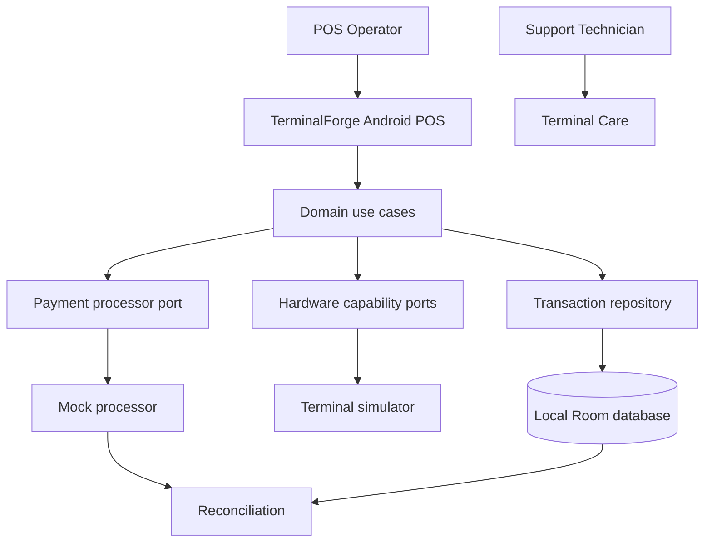

# TerminalForge

**Simulator-first Android POS Terminal Architecture Lab** built around Kotlin-first Android development, Java interoperability, transaction reliability, hardware abstraction, and security-by-design.

> Educational portfolio project only. Use synthetic data and mock/sandbox integrations. This is not production payment software and does not claim PCI DSS, EMVCo, card-scheme, or processor certification. Never use real cardholder data, PINs, cryptographic keys, or live payment credentials.

## Architecture at a glance

## Mermaid architecture diagrams

All diagrams are stored as editable Mermaid source under [`docs/diagrams/`](https://github.com/mburu1/TerminalForge/tree/main/docs/diagrams).

| Diagram | Purpose |
|---|---|
| [System context](docs/diagrams/context.mmd) | Users, Android app, domain, adapters, persistence, reconciliation, optional sandbox backend |
| [Container and module view](docs/diagrams/container-and-module-view.mmd) | Module responsibilities and dependency boundaries |
| [Transaction sequence](docs/diagrams/transaction-sequence.mmd) | Simulated sale, idempotency lookup, processor response, ambiguous outcomes |
| [Transaction state machine](docs/diagrams/state-machine.mmd) | Sale, unknown outcome, reconciliation, reversal, and refund states |
| [Deployment view](docs/diagrams/deployment.mmd) | Android device, development workstation, and optional sandbox services |
| [Idempotency and retries](docs/diagrams/idempotency-and-retries.mmd) | Duplicate prevention, key conflicts, safe retries, and reconciliation |
| [Reconciliation workflow](docs/diagrams/reconciliation.mmd) | Match local transactions to synthetic settlement records and classify discrepancies |
| [Hardware adapter boundary](docs/diagrams/hardware-adapter.mmd) | Reader, printer, status ports, simulator faults, future authorized adapters |
| [Terminal Care lifecycle](docs/diagrams/terminal-care-lifecycle.mmd) | Maintenance issue reporting, assignment, repair, verification, closure |
| [Security trust boundaries](docs/diagrams/security-trust-boundaries.mmd) | Threats, app boundaries, redacted diagnostics, synthetic-data constraints |
| [Quality and release pipeline](docs/diagrams/quality-and-release-pipeline.mmd) | Build, tests, lint, security review, reporting, human release gate |
| [Refund and reversal sequence](docs/diagrams/refund-reversal-sequence.mmd) | Separate operation preconditions and ambiguous-response handling |

## Architecture specification

See [TerminalForge POS Architecture README](TerminalForge_POS_Architecture_README.md) for the full product scope, Windows 11 setup, target repository tree, dependency rules, domain model, implementation milestones M0–M10, test strategy, and definition of done.

## Engineering principles

- Kotlin-first Android application; Java used where interoperability is useful.
- Keep domain rules independent of Android UI and concrete infrastructure.
- Route processor and hardware interactions through replaceable interfaces.
- Use idempotency keys, explicit transaction states, and reconciliation for ambiguous outcomes.
- Store money as integer minor units; never use floating-point arithmetic for amounts.
- Keep diagnostics redacted and use synthetic data only.
- Treat diagrams and architecture claims as documentation to keep aligned with implementation.

## Current status

The repository currently contains architecture documentation and Mermaid diagram sources. Treat the target structure and future backend as planned until their implementation, tests, and CI results are present. No build or test result is implied by the diagrams alone.
